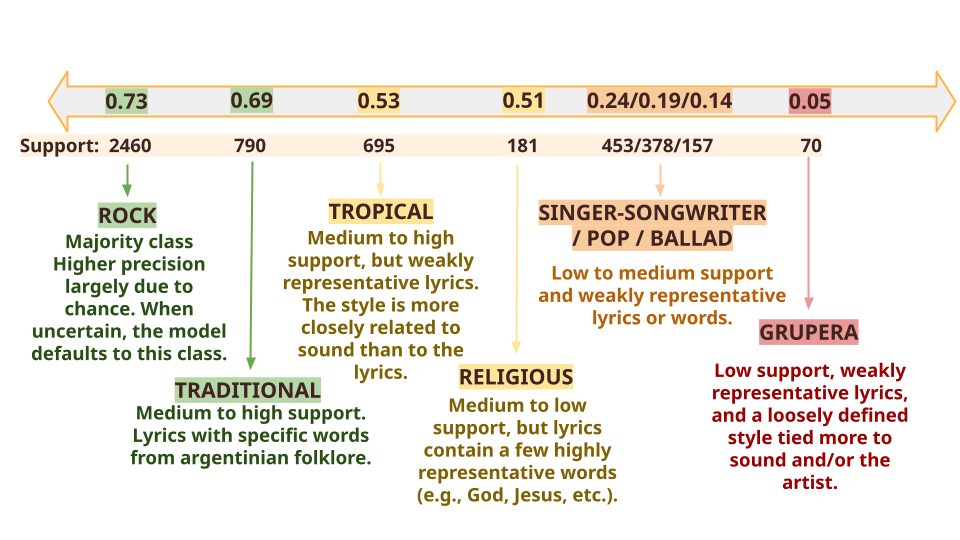

# Lectura distante de canciones argentinas

## Introducción

Este proyecto analiza un dataset de aproximadamente 30,000 letras de canciones argentinas extraídas del sitio [La Cuerda](https://lacuerda.net/), enriquecidas con metadatos de la API de Spotify. El objetivo es caracterizar y predecir estilos musicales a partir del análisis textual de las letras, utilizando técnicas de Procesamiento de Lenguaje Natural (NLP).

Este enfoque, conocido como *Lectura Distante*, permite descubrir patrones que serían imposibles de detectar mediante la lectura tradicional, revelando conexiones entre vocabulario, temática y género musical.

---

## Metodología

### 1. Recolección y preparación de datos

El primer paso consistió en obtener las letras de canciones desde La Cuerda, un repositorio colaborativo de acordes y letras. Posteriormente, se enriqueció el dataset con información de Spotify (popularidad, duración, artista) mediante su API.

El preprocesamiento incluyó:

- Limpieza de texto (eliminación de caracteres especiales y normalización)
- Lematización con spaCy para reducir palabras a su forma base
- Cálculo de métricas como TTR (Type-Token Ratio) para medir riqueza léxica

### 2. Análisis exploratorio y modelado de tópicos

Se aplicó **LDA (Latent Dirichlet Allocation)** para descubrir tópicos latentes en el corpus. Identificamos cinco tópicos principales: *religioso*, *existencial*, *naturista*, *desamor* y *folklórico*. Cada canción fue etiquetada con el tópico de mayor probabilidad.

### 3. Feature Engineering

Además de la vectorización del texto, diseñamos features adicionales:

- **Proporción de stopwords**: indicador de complejidad léxica
- **Proporción de palabras en inglés**: relevante para ciertos géneros como pop o rock
- **Longitud media de palabra**: asociada a estilos más tradicionales
- **Repeticiones**: frecuencia de palabras repetidas
- **Polaridad de sentimiento**: calculada con TextBlob

### 4. Vectorización del texto

Probamos múltiples técnicas de representación numérica:

- **TF-IDF**: pondera frecuencia de términos penalizando palabras muy comunes
- **Word2Vec**: embeddings que capturan relaciones semánticas (modelo propio y preentrenado)
- **BERT**: embeddings contextuales usando un modelo preentrenado en español

### 5. Clasificación

Entrenamos clasificadores para predecir el estilo musical:

- **Regresión Logística** (multinomial)
- **Support Vector Machines** (LinearSVC)

Cada combinación vectorización + clasificador fue evaluada usando F1-score macro para considerar el desbalance de clases.

---

## Problemas y soluciones

### Desbalance de clases

El dataset presenta una fuerte predominancia del rock sobre otros estilos. Esto generaba un sesgo sistemático hacia esa categoría.

**Solución**: Utilizamos el parámetro `class_weight='balanced'` en los clasificadores y priorizamos métricas como F1-macro que penalizan el sesgo hacia clases mayoritarias.

### Ambigüedad en la definición de "estilo"

Las etiquetas de estilo en La Cuerda mezclan criterios instrumentales, temáticos y de formación del grupo, generando categorías que no son mutuamente excluyentes.

**Solución**: Aceptamos esta limitación como parte del problema y complementamos el análisis con clustering no supervisado para descubrir agrupaciones naturales.

### Limitaciones de Word2Vec preentrenado

El modelo preentrenado en Wikipedia española tuvo peor desempeño que uno entrenado sobre nuestro corpus específico de canciones.

**Solución**: Entrenamos un modelo Word2Vec propio que captura mejor el vocabulario coloquial y poético de las letras argentinas.

### Letras ambiguas

Algunas canciones tienen letras que no reflejan claramente su estilo. Por ejemplo, canciones religiosas que nunca mencionan a Dios pero le hablan al oyente.

**Solución**: Documentamos estos casos como análisis de errores, reconociendo que el texto por sí solo no siempre determina el género musical.

---

## Resultados y conclusiones

### Desempeño de los modelos

| Técnica | Clasificador | F1-Macro |
|---------|--------------|----------|
| TF-IDF | Regresión Logística | **0.37** |
| TF-IDF | SVM | 0.34 |
| Word2Vec (propio) | SVM | 0.33 |
| BERT | SVM | 0.35 |
| Feature Engineering | SVM | 0.18 |

El modelo baseline (TF-IDF + Regresión Logística) obtuvo el mejor resultado. Técnicas más sofisticadas como BERT no mejoraron significativamente el desempeño, lo que sugiere que el cuello de botella está en la calidad de las etiquetas y el desbalance, no en la representación del texto.

### Precisión por estilo

El gráfico muestra la precisión del mejor modelo (TF-IDF + Regresión Logística) para cada estilo musical. Se observa una clara influencia del **número de muestras** y la **naturaleza del estilo** en la capacidad predictiva.

Este análisis refuerza la conclusión de que algunos estilos están intrínsecamente ligados a sus letras, mientras que otros dependen de factores musicales o contextuales que el texto no puede capturar.

### Hallazgos del análisis de coeficientes

El modelo de regresión logística reveló palabras discriminativas por estilo:

- **Rock**: *punk*, *mierda*, *aguante* (vocabulario directo y agresivo)
- **Religioso**: *jesús*, *espíritu*, *dios* (léxico espiritual explícito)
- **Tropical**: *cumbia*, *cuerpo*, *cariño* (referencias al baile y romance)
- **Tradicional**: *cantor*, *monte*, *andar* (imaginario folklórico)

### Clustering

Al aplicar K-means sobre las vectorizaciones, los clusters resultantes se alinearon más con los tópicos de LDA que con los estilos predefinidos. Esto sugiere que la estructura semántica de las letras no coincide perfectamente con las categorías de género asignadas externamente.

### Conclusiones

1. **Existe una relación entre texto y estilo**, pero es parcial. Las letras aportan información valiosa, especialmente para géneros definidos temáticamente (religioso, folklórico).

2. **El desbalance y la ambigüedad de etiquetas** son los principales limitantes, más que la técnica de vectorización elegida.

3. **El artista es un predictor fuerte**: al incluir información del artista, el desempeño mejora significativamente, lo cual tiene sentido dado que las bandas suelen mantenerse dentro de un estilo.

4. **La lectura distante complementa, no reemplaza**, el análisis tradicional. Permite identificar patrones a escala, pero requiere interpretación humana para validar los hallazgos.

Este proyecto demuestra el potencial del NLP para analizar corpus culturales masivos, revelando la compleja relación entre palabras, música e identidad en la canción popular argentina.

## Links

!TODO:

- Link a los notebooks
- Link a las diapositivas

## Agradecimientos

Este trabajo fue producto de la mentoria dirigida por MENTOR en el contexto de la Diplamtura en Ciencia de Datos, Aprendizaje Automático y sus Aplicaciones (FAMAF) y fue realizado en conjunto con Lauti e Ivan. A ellos muchas gracias :)
